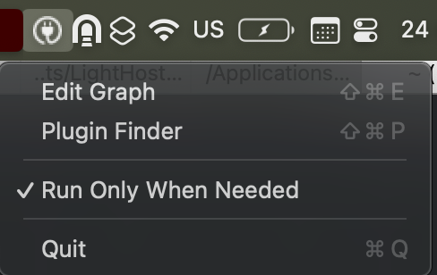
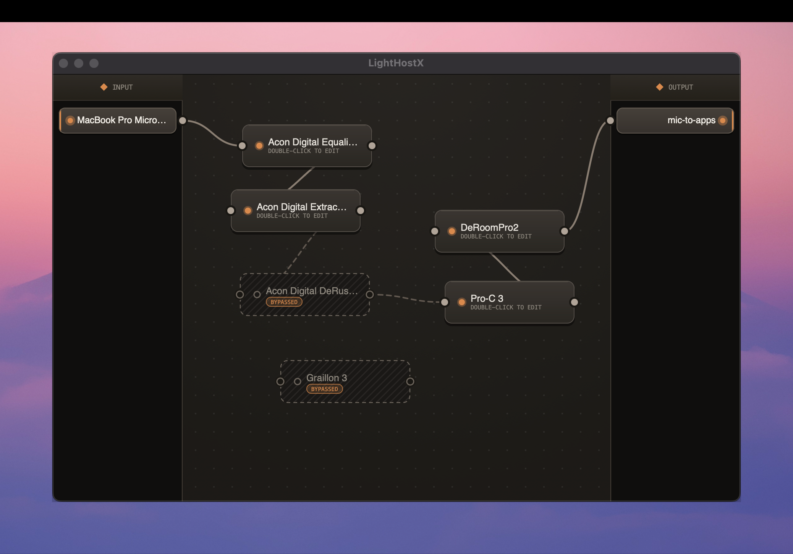

Light Host
---

A simple VST/AU host for OS X that sits in the menu/task bar.
This is a rewrite of https://github.com/opencma/LightHost core loop in
Objective-C for native menu looks and some other MacOS-only fixes.

To run provided build, place it into your Applications folder and run `codesign -fs - /Applications/LightHostX.app`.

